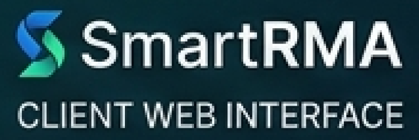
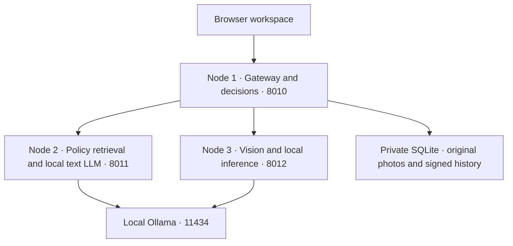

<p align="center"></p>

# Multi-Model Agentic RAG System for Automated RMA

**SmartRMA** is a local hardware-return screening application built with **Python, FastAPI, SQLite, HTML, CSS and JavaScript**. Upload original product photos, inspect them with a locally installed vision model, retrieve manufacturer policy passages, and retain the evidence and decision in signed case history.

The application runs **three separate backend processes**. Vision and text LLM inference goes through **local Ollama**; the optional trained hardware classifier runs in local ONNX Runtime. No hosted AI provider, cloud inference endpoint or AI API key is supported. Local HTTP APIs connect the browser, nodes and Ollama.

## Three-node workflow



| Component | Responsibility |
|---|---|
| **Node 1** | Serves the UI, validates uploads, saves durable jobs, coordinates the other nodes, applies decision rules, and owns the database and audit history. Runs no LLM. |
| **Node 2** | Retrieves manufacturer-specific policy passages with document/page citations and executes policy chat through its own local Ollama text-model client. Current retrieval uses lexical keyword scoring. |
| **Node 3** | Inspects photos and answers selected-photo questions with local vision models. Its inference lock is shared with Node 2 to prevent competing model loads. |

Inspection follows **Node 1 → Node 3 → Node 1 → Node 2 → Node 1 decision**. Policy chat follows **Node 1 → Node 2 → local Ollama text model**. The architecture page shows this flow and live node health; its replay is illustrative, not request telemetry.

## Requirements

- Python **3.12 or newer**; the retained development environment uses **Python 3.14.6 on macOS**.
- Ollama running on `127.0.0.1:11434`, with supported models downloaded locally.
- Sufficient RAM and disk space for the selected models; the application serializes its model calls.
- Free local ports **8010, 8011 and 8012**, and a local filesystem for SQLite.

Package installation and initial model downloads need internet access. Inference uses local model weights. The application does not download or start models automatically.

## Quick start

```sh
git clone https://github.com/HappyDeswal/SmartRMA_Final.git
cd SmartRMA_Final
python3 -m venv .venv
source .venv/bin/activate
python3 -m pip install -r requirements.lock
```

Install the primary models once:

```sh
ollama pull qwen3-vl:8b
ollama pull qwen2.5:7b
```

If Ollama is not running, start it in a separate terminal:

```sh
OLLAMA_NO_CLOUD=1 ollama serve
```

Then start the three application nodes:

```sh
python3 run.py
```

Open **http://127.0.0.1:8010**. On macOS, after setup, `start.command` also launches the cluster. Stop the launcher with **Ctrl+C**. Check all three nodes with:

```sh
python3 run.py --status
```

### Local workspace access

The browser opens directly into the local administrator workspace, with **no login page**. Automatic entry requires both a loopback client connection and a loopback configured origin. Backend sessions, CSRF protection, authorization and account administration remain active.

A fresh private data directory generates an administrator, a random bootstrap password and an audit key. Bootstrap credentials are stored in `var/first_login.json`; changing the password through **Account** removes that file and revokes previous sessions. `var/` is private runtime data and is excluded from this repository.

`HAPPY_LOCAL_AUTO_LOGIN=0` disables automatic entry. The bundled UI has no interactive login form, so this setting requires an authenticated client/integration using the backend login endpoint. Remote access is not a ready-to-use public browser deployment; review authentication and TLS before exposing it.

## Using the application

1. Enter an order reference, supported hardware type, product/model, declared USD value and complaint. Manufacturer and serial identity are advisory.
2. Upload **1–5 original photos** of the same item. Prefer full front/back views plus contacts, suspected damage and identifier-label details.
3. Submit the case. Original photos and a durable job are saved immediately; the browser shows processing progress.
4. Local vision records structured observations, policy retrieval supplies relevant passages, and the gateway applies the configured rules.
5. Open **Review / History** to inspect photos, findings, citations, saved decisions, historical snapshots and exports. Record a reason when making a human decision.

Accepted images: single-frame **JPEG, PNG, WebP and BMP**, up to **10 MiB each / 25 MiB combined**. Animated and malformed files are rejected. Supported products: **graphics cards, motherboards, RAM and SSDs**.

### Preset decision rules

| Tier | Declared value | Routing | Minimum clean-condition confidence |
|---|---|---|---|
| T1 | Below $300 | Automatic approve/reject | 85% |
| T2 | $300–$1,000 inclusive | Automatic approve/reject | 85% |
| T3 | Above $1,000 through $2,500 inclusive | Automatic approve/reject | 95% |
| T4 | Above $2,500 | **Mandatory human approval or rejection** | AI evidence only |

Automatic approval also requires **risk below 30**, consistent usable observations for every submitted photo, and no visible damage/wear/tampering, editing metadata, similar-photo warning or grounded exclusion. Exactly **$2,500 belongs to T3**.

An unavailable or inconclusive inspection produces an evidence-resubmission rejection; it is not a confirmed damage or fraud diagnosis. Missing OCR identity or indexed manufacturer policy remains advisory. Only T4 has a mandatory human gate; reviewers can optionally re-evaluate other completed cases with a recorded reason.

## Local models

| Task | Preference order |
|---|---|
| Vision / photo questions | `qwen3-vl:8b` → `llama3.2-vision:latest` → `moondream:latest` |
| Text / policy chat | `qwen2.5:7b` → `qwen2.5-coder:14b` → `ornith:35b` → `llama3.1:8b` |

Only installed supported candidates are used. Qwen/Llama vision output must pass the condition schema. Moondream descriptive output is retained as inconclusive evidence and does not create invented confidence. Installation alone does not demonstrate successful inference.

The transport rejects remote/cloud aliases, proxy routing and redirects. The inference lock coordinates this application's calls; other applications may still compete for Ollama resources.

## Features

- Intake with original-photo preservation, preview and upload validation.
- Durable inspection queue, bounded retries, idempotent submissions and restart recovery.
- Deterministic financial routing with a T4 human-review boundary.
- Review/history, original-image exports and immutable decision snapshots.
- Manufacturer policy search with source-document access and citations.
- Local policy chat and selected-photo questions.
- Architecture workflow, live node health, light/dark themes and responsive layouts.
- Local sessions, roles, account management and CSRF/Origin/Host checks.
- SHA-256 photo identifiers, HMAC-sealed audit history and integrity verification.
- Consistent SQLite backups with the matching audit key.

## Project layout

```text
app/                 Backend, node services, rules, models, policy and storage
web/                 Browser UI, styles, scripts and branding assets
resources/policies/  Local policy documents, provenance and retrieval index
sample_data/         20 attributed demonstration photos grouped by T1–T4
tests/               Isolated Python tests and optional browser/live diagnostics
docs/                Architecture and deployment/recovery notes
run.py               Three-node launcher and status command
manage.py            Integrity, backup, policy rebuild and admin recovery
requirements.lock    Pinned runtime dependencies
```

The original repository now contains the consolidated application directly at its root. The separate rebuilt folder is retired. The internal `happy_project` identifier and `HAPPY_*` environment variables remain for compatibility.

## Verification

From the repository root, with the virtual environment active:

```sh
python3 -m unittest discover -s tests -v
python3 -m pip check
```

The Python suite uses disposable data directories and controlled model fixtures to test application behavior. It does not establish vision accuracy or reproduce journal benchmarks. [TEST_REPORT.md](TEST_REPORT.md) records earlier live and browser verification separately from the publication check.

Browser diagnostics in `tests/*.cjs` additionally require Node.js, Playwright and Chrome; the retained scripts target macOS Chrome and fixed local fixture ports. Live scripts can create labelled demonstration cases and require local credentials. They are opt-in diagnostics, not startup steps. Generated logs, screenshots and runtime case records are excluded from Git.

## Operations and recovery

```sh
python3 manage.py verify
python3 manage.py backup /absolute/path/to/new-private-backup
# Stop the application before administrator recovery:
python3 manage.py reset-admin
# After editing trusted local policy documents, rebuild and restart:
python3 manage.py rebuild-policies
```

Keep a backup's `.happy_data`, `happy.sqlite3` and `audit.key` together. Restore to a **new private directory** with the server stopped, set `HAPPY_DATA_DIR` to it, then run `manage.py verify` before starting. Do not overlay an active database or mix audit keys. Backups contain private photos and password hashes and require protected storage.

| Environment variable | Default | Purpose |
|---|---|---|
| `HAPPY_DATA_DIR` | Repository `var/` | Private database, original photos and audit key |
| `HAPPY_ORIGIN` | `http://127.0.0.1:8010` | Exact browser/application origin |
| `HAPPY_LOCAL_AUTO_LOGIN` | `1` | Local automatic administrator session |
| `HAPPY_SECURE_COOKIE` | `0` | Set `1` for reviewed HTTPS deployments |

See [architecture](docs/ARCHITECTURE.md) and [deployment and recovery](docs/DEPLOYMENT.md) for node boundaries and operational details.

## Data attribution and scope

The demonstration set contains **20 attributed photos**, five per tier, with synthetic test prices. Conditions are not independently annotated. Preserve [sample image credits](sample_data/CREDITS.md) and [the manifest](sample_data/manifest.json) when reusing them.

The included corpus has **26 local policy documents** and **1,423 indexed chunks** in the retained snapshot. Policy documents retain their publishers' rights; review their current region, date and product applicability. This repository does not grant new rights to third-party material.

The application performs **screening and traceable review**. It does not issue refunds, manufacturer authorizations, shipping labels or external tickets. Photos cannot prove hidden electrical defects or purchase eligibility, and model confidence is not calibrated diagnostic accuracy. Passing tests is not a guarantee of zero defects or production readiness; independent evaluation and deployment acceptance remain necessary.

## Optional hardware model trained in Colab

The [hardware training workflow](training/README.md) and self-contained
[Colab notebook](training/SmartRMA_Hardware_Training.ipynb) train a small
MobileNetV3 classifier on versioned GPU, motherboard, RAM and SSD photographs.
The prepared dataset contains 971 original images (679 train, 147 validation,
145 test) after exact duplicate removal and near-duplicate grouping. Public
source labels are hardware types; they are not damage or warranty labels.

Download the Colab export, install `requirements-hardware.txt`, then run
`python training/install_model.py /path/to/smartrma_hardware_bundle.zip` and
restart the application. Node 3 serves the model locally through ONNX Runtime.
Hardware recognition appears as an advisory in case history; the existing local
vision LLM still assesses visible condition. Recognition scores do not replace
condition confidence, affect return decisions, or bypass T4 human approval.
See the training documentation for attribution, measured results and dataset
limits. Training data and weights are excluded from source commits.

The [workflow parity comparison](docs/WORKFLOW_PARITY.md) maps the original and rebuilt node responsibilities and distinguishes preserved behavior from implementation improvements.

## Consolidated project (29 October 2026)

The maintained project is now SmartRMA_Final. Run `python3 run.py` from this folder. Gateway/UI remains on port 8010, policy/text on 8011 and vision on 8012. The implementation, local-only LLMs, trained advisory classifier and preset return rules are carried over from the rebuilt project. There is one active launcher and application.

Existing rebuilt SQLite history, original uploads, matching audit key and installed local classifier were preserved in private `var/`. Earlier JSON dossiers and audit records are preserved in local `legacy_data/` and a verified recovery ZIP under `output/backups/`. They are not imported into the signed SQLite history or displayed as newly evaluated cases. Pre-consolidation academic figures remain historical and are not evidence of current model accuracy. See [migration notes](docs/CONSOLIDATION.md).
