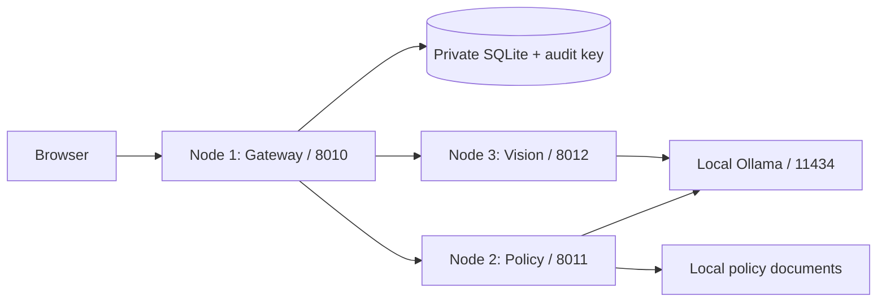

# Architecture

The browser loads a single-origin HTML/CSS/JavaScript application. FastAPI provides authentication, intake, asynchronous job tracking, case/history/export, source-policy search and PDFs, local chat, photo questions, user administration and integrity checks. It never serves the data directory.

The normal launcher runs three independent services, preserving the original project’s three-node separation:

| Node | Port | Responsibility |
|---|---|---|
| 1 — Gateway | 8010 | Browser, login/local entry, upload validation, durable jobs, deterministic decisions, signed history, SQLite |
| 2 — Policy | 8011 | Manufacturer-scoped search, source documents, policy advisory, local text-model chat |
| 3 — Vision | 8012 | Local Ollama model inventory, image inspection, photo Q&A and local vision-model execution |

The browser talks only to Node 1. Internal routes require a private random token generated by the launcher and shared through child-process environments. Internal listeners bind to loopback; no cloud endpoint or permissive CORS is introduced. Node 2 never opens the database. Nodes 2 and 3 acquire the same operating-system file lock before executing Ollama requests. Node 2 runs the text model itself; Node 3 runs vision requests. Separate processes cannot simultaneously load competing application models, and the operating system releases the file lock when its process exits. The launcher creates the private lock file in the data directory and supplies its path to both children. Original image bytes travel only over authenticated loopback to Node 3; the local model receives a scaled copy.

The launcher checks ports, starts Nodes 2 and 3, waits for their health endpoints, starts Node 1, monitors child exits and terminates its own children on shutdown. A failed child causes the cluster to exit for a process supervisor to restart it. Node 1 recovers interrupted jobs on restart. A request to an unavailable node fails visibly; it does not silently run local in-process fallback or produce an approval. Controlled unit tests can inject in-process providers without starting servers; the normal `run.py` always selects the three-node HTTP providers.

- `app/nodes.py`: private loopback node clients, response validation and unavailable-node handling.
- `app/service.py`: the separate Node 2 and Node 3 service entry points.
- `run.py`: three-process startup, status and shutdown supervision.
- `app/domain.py`: validated request/observation models and deterministic tier decisions.
- `app/images.py`: bounded raster validation, original SHA-256 and perceptual comparison; scaled copies for inference only.
- `app/storage.py`: SQLite transactions, deduplicated original photo BLOBs, cases, jobs, sessions, signed accounts, idempotency and chained signed snapshots.
- `app/auth.py`: scrypt passwords, opaque server sessions, rate limits and first-run credentials.
- `app/models.py`: fixed-loopback Ollama transport, model allowlists, serialization, response validation, fallbacks and readiness.
- `app/policy.py`, `app/indexing.py`: local manufacturer-scoped lexical retrieval and atomic offline PDF/Markdown indexing. Processor-only sources are excluded from the four supported classes; citations remain advisory.
- `app/worker.py`: one durable inspection worker, timeout budgets, restart recovery and technical-failure retry.
- `app/main.py`: routes, role checks, bounded request spooling, CSRF, Host/Origin checks and security headers.
- `web/`: browser interface with no external scripts/fonts and text-safe rendering.

Submissions and automatic/human/archive decisions append complete immutable snapshots to a SHA-256 chain with HMAC signatures. The database-only attacker cannot silently rewrite signatures without the private audit key. This does not protect against an attacker controlling the operating-system account, both key and database, or replacing the whole data directory with an older valid backup. Keep independent backups if rollback detection is required. Historical exports use the event snapshot, not the current case fields; stored original photos are verified by their content hash.

Job progress and sessions are operational records rather than audited business outcomes. An interrupted job returns to the queue on restart; a failed technical job is visible and retryable. The final decision commits with the final snapshot and job completion in one transaction. A repeated submission key with identical content returns the same case/job; different content conflicts. Mandatory human review is determined by the declared price, never by model prose.

SQLite uses WAL on versions containing the WAL-reset fix and rollback-journal mode otherwise. Use one gateway/database owner, one policy process and one vision process per deployment; run one worker per service. The backend performs CPU/file work locally and is intended for a single workstation/team workflow, not horizontal multi-server scaling.

See [WORKFLOW_PARITY.md](WORKFLOW_PARITY.md) for the original-to-rebuilt node mapping and price-rule comparison.
